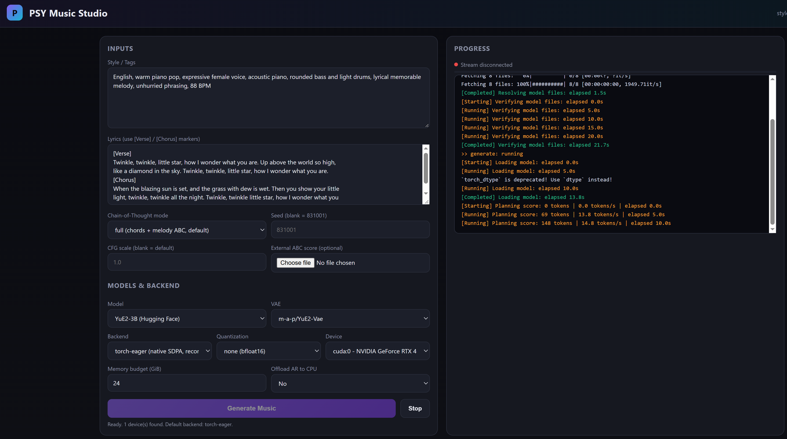

<p align="center">
  
</p>

<h1 align="center">PSY Music Studio</h1>

<p align="center">
  <strong>yue2 webui</strong> — a free, open-source AI music generator that turns
  <em>style + lyrics</em> into full songs with vocals, 100% locally on your own GPU.
  Built on the <a href="https://github.com/multimodal-art-projection/YuE">YuE2</a> pipeline.
  No sign-up, no subscription, no cloud credits, no watermarks — your lyrics never
  leave your machine.
</p>

<p align="center">
  <a href="https://github.com/pyshine-labs/psy/stargazers"></a>
  <a href="https://github.com/pyshine-labs/psy/network/members"></a>
  <a href="https://github.com/pyshine-labs/psy/blob/main/LICENSE"></a>
  
  <a href="https://www.youtube.com/watch?v=9RxxBSqbKLE"></a>
</p>

<p align="center">
  
</p>

<p align="center">
  <a href="#installation">Installation</a> ·
  <a href="#usage">Usage</a> ·
  <a href="#features">Features</a> ·
  <a href="#why-psy-music-studio">Why PSY</a> ·
  <a href="#credits--license">Credits</a>
</p>

---

<div align="center">

[](https://www.youtube.com/watch?v=9RxxBSqbKLE)

</div>

## Quick start (TL;DR)

```powershell
git clone https://github.com/pyshine-labs/psy.git
cd psy
python -m venv .venv
.\.venv\Scripts\Activate.ps1          # Windows (source .venv/bin/activate on Linux/macOS)
pip install -e . fastapi uvicorn
.\run.bat                             # or ./run.sh — opens the studio in your browser
```

## Overview

**PSY Music Studio** is a single-file FastAPI web UI that wraps the
[YuE2](https://github.com/multimodal-art-projection/YuE) song-generation pipeline.
YuE2 is a *style + lyrics → symbolic plan → song* model developed by the
Multimodal Art Projection (m-a-p) team. This repo packages that pipeline behind
a friendly browser interface so you can:

- Choose model / VAE / backend / quantization / device from dropdowns,
- Enter a music style and lyrics (with `[Verse]` / `[Chorus]` markers),
- Watch the resolve → verify → load → plan → generate → synthesize → decode
  pipeline stream progress in real time,
- Play the result inside the page, download it as `.flac`, or open its
  containing folder.

The full YuE2 source is included under [`src/yue2`](./src/yue2). Upstream code
is unchanged except for a few small Windows patches: all artifact/log files
are written as UTF-8 and progress output replaces unmappable characters, so
Chinese (and any non-ASCII) lyrics work out of the box.

## Why PSY Music Studio?

Most AI music generators (Suno, Udio, Riffusion…) are hosted services: you pay
per song, wait in queues, and the lyrics + audio live on someone else's server.
PSY Music Studio is the opposite — a **local, offline AI song generator**:

- 🆓 **Free & open source** — unlimited song generation, no per-track credits
- 🔒 **Private by design** — text-to-song runs entirely on your hardware; no
  account, no telemetry, no uploads
- 🎤 **Full songs with vocals** — verse/chorus structure, male/female/duet
  vocals, in English, Mandarin and 10+ languages
- 🎛️ **Pro-grade output** — studio-quality **FLAC** audio you can download and
  use; see `MODEL_LICENSE` for commercial-use terms
- 🖥️ **Bring your own GPU** — anything from 8 GiB VRAM (fp8 quantization +
  CPU offload) to multi-GPU setups; Windows, Linux, macOS
- 🌐 **Bilingual UI** — English / 中文 interface, multilingual lyrics
- 🧩 **The missing WebUI for YuE2** — model picker, quantization, backends
  (torch-eager / torch / vLLM), live progress, profiles, one-click launchers

If you generate songs with Suno-like prompts but want them **generated locally
with AI** — this is your tool. Works great for songwriters, content creators,
game developers, and anyone experimenting with open-source music AI models.

## Features

- **No build step** — one `webui.py` file, vanilla HTML/CSS/JS.
- **Live progress** via Server-Sent Events; every `[YuE2] ...` stderr line is
  shown in the UI with a status pill and a progress bar.
- **Inline audio player**, plus Download `.flac` and Open-containing-folder
  buttons.
- **Auto-discovery** of cached Hugging Face models and CUDA devices.
- **Backend selector**: `torch-eager` (native SDPA, works without flash-attn),
  `torch` (CUDA graphs + flash), or `vllm`.
- **Profiles — save / load / delete** named snapshots of the entire form
  (style, lyrics, model & backend settings) as JSON in `profiles/`. Profiles
  live on the server, so they are shared by every device on your LAN.
- **UI language: English / 中文** — every label, button, preset and status
  message switches via the header selector (auto-detects your browser
  language on first visit). Model-facing tags always stay English for
  generation quality.
- **CUDA out-of-memory auto-fallback** — if a generation OOMs, the WebUI
  automatically retries once with fp8 weights, AR-offload-to-RAM and a
  smaller VAE tile budget instead of dying with a traceback.
- **Non-ASCII lyrics safe** — request/plan/result artifacts, worker logs and
  console progress are UTF-8 / error-replaced, so Chinese lyrics never hit
  the Windows "charmap codec can't encode" error.
- **One-click launchers** for Windows (`run.bat`) and Linux/macOS (`run.sh`)
  that auto-detect your venv and open the browser.
- **Windows-safe**: uses the Selector event loop to avoid cosmetic
  `WinError 10054` connection-reset noise from SSE clients.

## Example: Twinkle Twinkle, Little Star

Below is a complete example using the classic nursery rhyme. Both versions
were generated with PSY Music Studio using the same lyrics but different
vocal styles. Click play to hear them right in the README.

**Lyrics used:**

```
[Verse]
Twinkle, twinkle, little star, how I wonder what you are.
Up above the world so high, like a diamond in the sky.
Twinkle, twinkle, little star, how I wonder what you are.

[Chorus]
When the blazing sun is set, and the grass with dew is wet.
Then you show your little light, twinkle, twinkle all the night.
Twinkle, twinkle little star, how I wonder what you are.
```

### Male vocal version

> Style: `English, male voice, pop, acoustic piano, light drums, warm, heartfelt, 88 BPM`

<audio controls style="width:100%">
  <source src="assests/male.flac" type="audio/flac">
</audio>

[⬇ Download male.flac](./assests/male.flac) (14 MB)

### Female vocal version

> Style: `English, female voice, pop, acoustic piano, light drums, warm, lyrical melody, 88 BPM`

<audio controls style="width:100%">
  <source src="assests/female.flac" type="audio/flac">
</audio>

[⬇ Download female.flac](./assests/female.flac) (13.2 MB)

## Song templates — copy & paste

Everything below goes into the two text boxes in the **Inputs** panel:
the **Style / Tags** line (or let the Genre Preset / chips build it for you)
and the **Lyrics** box. Replace the sample lines with your own and keep the
`[Verse]` / `[Chorus]` markers — YuE2 uses them to structure the song.

### How a style tag is built

```
Language, vocal, genre, instruments, mood / phrasing, tempo
    ↓         ↓       ↓         ↓              ↓           ↓
 English, female voice, pop, acoustic piano + light drums, warm, 88 BPM
```

- **Language** — `English`, `Mandarin`, `Spanish`, `Japanese`, … (also the
  language the model sings in)
- **Vocal** — `male voice`, `female voice`, `duet (male + female)`, `choir`
- **Instruments** — 2–4 works best; e.g. `acoustic piano, 808 bass, trap hi-hats`
- **Mood / phrasing** — `warm`, `energetic`, `melancholic`, `anthemic`,
  `lyrical memorable melody`, `unhurried phrasing`, …
- **Tempo** — BPM number: ballads 60–80, pop 88–120, dance 120–130, rock 130–150,
  punk 160–180

### Template 1 — Pop (radio-friendly)

> Style: `English, female voice, pop, acoustic piano, rounded bass, light drums, warm, lyrical memorable melody, 100 BPM`

```
[Verse]
Type two lines about the moment the story starts...
and two more lines that set the scene...

[Chorus]
Type the hook here — short, catchy, repeatable...
Make it the emotional punchline of the song...

[Verse]
Second scene — what changed after the chorus...

[Chorus]
Repeat the hook...

[Outro]
One closing line, fading out...
```

### Template 2 — Rock anthem

> Style: `English, male voice, rock, distorted electric guitar, heavy bass, driving drums, energetic, anthemic, raw, 140 BPM`

```
[Verse]
Gritty opening — where the frustration comes from...

[Chorus]
Big shout-along hook — one idea, loud...

[Verse]
Escalate — stakes get higher...

[Chorus]
Repeat the hook...

[Bridge]
Strip down — half volume, one promise or threat...

[Chorus]
Final repeat — max energy...
```

### Template 3 — Hip-hop / rap

> Style: `English, male voice, hip-hop, deep 808 bass, crisp snare, dark piano loop, hi-hat triplets, aggressive, street, confident, 90 BPM`

```
[Verse]
Eight to twelve bars — long lines, internal rhymes...

[Verse]
Second verse — flip the perspective or answer back...

[Chorus]
Short chant — 2 lines max, easy to remember...
```

### Template 4 — EDM / dance

> Style: `English, female voice, electronic, analog synth pads, pulsing bass, four-on-the-floor kick, shimmering arpeggios, ethereal, dreamy, atmospheric, 128 BPM`

```
[Verse]
Light, airy lines — let the beat do the work...

[Chorus]
Simple uplifting hook — 4 short lines...

[Verse]
Second drop setup...

[Chorus]
Repeat the hook...
```

### Template 5 — Heartfelt ballad

> Style: `English, female voice, pop, acoustic piano, warm strings, intimate, heartfelt, unhurried phrasing, 72 BPM`

```
[Verse]
One small concrete detail — a room, a habit, a name...

[Chorus]
The feeling, said plainly — this is the line people hum...

[Bridge]
The turn — what you wish you had said...

[Chorus]
Final repeat, softer or bigger...
```

### Template 6 — 华语流行 (Mandarin pop)

> Style: `Mandarin, female voice, pop, acoustic piano, rounded bass, light drums, warm, lyrical memorable melody, 88 BPM`

```
[Verse]
第一段主歌 — 两行场景，两行情绪...

[Chorus]
副歌 — 短句、易记、重复核心意象...

[Verse]
第二段主歌 — 故事推进...

[Chorus]
副歌重复...

[Outro]
尾句收束...
```

### Template 7 — Jazz lounge

> Style: `English, female voice, jazz, acoustic piano, tenor saxophone, upright bass, brushed drums, intimate, spacious modern harmony, natural phrasing, 95 BPM`

```
[Verse]
Conversational opening — like telling a friend a secret...

[Chorus]
Smoky refrain — one clever turn of phrase...

[Verse]
Second take on the story...

[Chorus]
Repeat the refrain...
```

### Template 8 — Epic cinematic (choir)

> Style: `English, female voice, orchestral, full string section, french horns, timpani, dramatic choir, soaring, epic, cinematic, grand, 70 BPM`

```
[Verse]
Set the world — vast imagery, few words...

[Chorus]
The anthem moment — 2–4 lines built to swell...

[Bridge]
Quiet before the final rise...

[Chorus]
Final swell...
```

### Tips

- **Short songs first**: 2 verses + 2 choruses (~1.5–3 min) generates faster
  and more reliably than very long lyrics. Output is capped at ~6 minutes.
- **Style tags are English keywords** even when the lyrics are Chinese — the
  model follows them best that way.
- **One idea per section** — YuE2 treats each `[Chorus]` as the memorable part.
- Save your best combos with **Profile → Save** so you can reload them later.

## Installation

You need **Python 3.10+** and (optionally, but strongly recommended) an
**NVIDIA CUDA GPU** with ≥ 12 GiB VRAM. CPU-only works but is extremely slow.

### 1. Clone

```bash
git clone https://github.com/pyshine-labs/psy.git
cd psy
```

### 2. Create a virtual environment

```powershell
# Windows (PowerShell)
python -m venv .venv
.\.venv\Scripts\Activate.ps1
```

```bash
# Linux / macOS
python -m venv .venv
source .venv/bin/activate
```

### 3. Install YuE2 + this WebUI

```bash
pip install -e .
```

This installs the `yue2` package (and its dependencies: `torch`, `transformers`,
`safetensors`, `soundfile`, `tiktoken`, …) from the bundled source under
`src/yue2`.

### 4. Install a CUDA-enabled PyTorch (GPU users)

The `pip install -e .` step installs the CPU-only torch wheel by default.
To use your NVIDIA GPU, replace it with a matching CUDA build:

```bash
# Example: torch 2.10 + CUDA 12.6 (Windows, Python 3.12)
pip install --force-reinstall --no-deps \
    torch==2.10.0+cu126 \
    torchvision==0.25.0+cu126 \
    torchaudio==2.10.0+cu126 \
    --index-url https://download.pytorch.org/whl/cu126
```

Pick the index URL that matches your driver's CUDA version:

| CUDA | Index URL |
|------|-----------|
| 12.6 | `https://download.pytorch.org/whl/cu126` |
| 12.4 | `https://download.pytorch.org/whl/cu124` |
| 12.1 | `https://download.pytorch.org/whl/cu121` |

> ⚠️ If you see `USE_FLASH_ATTENTION was not enabled for build`, your torch
> wheel was not compiled with flash-attention. Use the **`torch-eager`**
> backend in the WebUI — it falls back to PyTorch's native SDPA kernel and
> works on every CUDA torch build.

### 5. Install FastAPI + Uvicorn (the WebUI server)

```bash
pip install fastapi uvicorn
```

> (These are the only two extra dependencies the WebUI adds on top of YuE2.)

## Usage

### One-click launch

```powershell
# Windows
.\run.bat
```

```bash
# Linux / macOS
./run.sh
```

The launcher auto-detects your venv, starts the server, and opens your browser
at <http://127.0.0.1:7860>.

### Manual launch

```bash
python webui.py
# or with custom host/port — use 0.0.0.0 to reach the UI from other
# devices on your LAN (phone, tablet, another PC)
python webui.py --host 0.0.0.0 --port 8000
```

### In the browser

1. **Inputs** panel — edit the Style/Tags and Lyrics textareas. Use
   `[Verse]` / `[Chorus]` markers; YuE2 understands them.
2. **Models & Backend** panel — pick a Model, VAE, Backend, Quantization,
   Device, and Memory budget. On a single-GPU Windows machine the defaults
   (`m-a-p/YuE2-3B`, `torch-eager`, `cuda:0`, 24 GiB) are usually correct.
3. Click **Generate Music**. The Progress panel streams every pipeline stage
   (Resolving → Verifying → Loading → Planning score → Generating song →
   Synthesizing audio → Loading audio decoder → Decoding audio).
4. **Profiles** — type a name and click **Save** to snapshot the whole form;
   pick one from the dropdown and **Load** to restore it, or **Delete** to
   remove it. Profiles are stored server-side in `profiles/*.json`.
5. **Language** — use the selector in the top-right header to switch the
   whole interface between English and 中文.
6. When it finishes, the Result panel appears with:
   - an inline `<audio>` player,
   - **Download .flac**,
   - **Open containing folder** (highlights the generated `audio.flac` in
     Explorer/Finder/your file manager).

### Command-line (original YuE2 CLI)

The original `yue2` CLI still works:

```bash
yue2 generate --output runs/my-song --style "English, warm piano pop" \
    --lyrics "[Verse]\nHello world"
```

See `examples/README.md` for the example lyrics request format.

## Repository layout

```
psy/
├── webui.py              # PSY Music Studio WebUI (FastAPI + SSE)
├── run.bat               # Windows launcher
├── run.sh                # Linux/macOS launcher
├── profiles/             # Saved UI profiles (created at runtime, git-ignored)
├── examples/             # Original YuE2 example lyrics + generate.py
├── src/yue2/             # YuE2 package (cli, pipeline, models) + UTF-8 patches
├── tests/                # YuE2 test suite
├── docs/                 # YuE2 documentation
├── skills/               # YuE2 skill / agent definitions
├── assets/               # Logo + architecture images
├── assests/              # Demo audio (male.flac, female.flac) for README
├── licenses/             # Third-party license texts
├── pyproject.toml        # Installs the bundled yue2 package
├── LICENSE               # Apache 2.0 (inherited from YuE2)
├── MODEL_LICENSE         # Model weight license
└── THIRD_PARTY_NOTICES.md
```

## Support the project ⭐

If PSY Music Studio helped you make a song, please **give it a star** — it is
the single best way to help other people discover free, local AI music
generation.

<p align="center">
  <a href="https://github.com/pyshine-labs/psy">
    
  </a>
</p>

<p align="center">
  <a href="https://www.star-history.com/?type=date&repos=pyshine-labs%2Fpsy">
    <picture>
      <source media="(prefers-color-scheme: dark)" srcset="https://api.star-history.com/chart?repos=pyshine-labs/psy&type=date&theme=dark&legend=top-left" />
      <source media="(prefers-color-scheme: light)" srcset="https://api.star-history.com/chart?repos=pyshine-labs/psy&type=date&legend=top-left" />
      
    </picture>
  </a>
</p>

## Credits & License

**PSY Music Studio** is a thin web wrapper authored by
[Pyshine Labs](https://github.com/pyshine-labs). All of the actual
song-generation intelligence — the model, the symbolic-plan + codec-token
pipeline, the VAE, and the sampling code under `src/yue2/` — is the work of
the **YuE2 / Multimodal Art Projection (m-a-p)** team:

- **YuE2 upstream:** <https://github.com/multimodal-art-projection/YuE>
- **YuE2 models on Hugging Face:**
  - <https://huggingface.co/m-a-p/YuE2-3B>
  - <https://huggingface.co/m-a-p/YuE2-Vae>

If you use PSY Music Studio in research or product work, please cite the
YuE2 model and the m-a-p team as the source of the generation pipeline.

## Troubleshooting

| Symptom | Fix |
|---|---|
| `Torch not compiled with CUDA enabled` | Install a `+cuXXX` torch wheel (see Installation §4). |
| `USE_FLASH_ATTENTION was not enabled for build` | Switch backend to `torch-eager` in the WebUI. |
| `backend must be torch, torch-eager, or vllm` | Refresh the page (stale dropdown) and pick a backend value. |
| `ConnectionResetError [WinError 10054]` in console | Cosmetic only — already handled by the Selector event loop in `webui.py`. Generation still succeeds. |
| `torch.cuda.OutOfMemoryError` | Close other GPU apps, or let the auto-fallback handle it — the WebUI retries once with fp8 weights + AR-to-RAM offload (visible in the log). |
| `'charmap' codec can't encode character ...` | Fixed in this repo: artifacts, logs and progress are written as UTF-8 (`PYTHONUTF8=1` is set by `run.bat`). Restart via `run.bat` after updating. |
| First Generate is very slow | Model weights download (~6 GiB) and are cached. Subsequent runs skip the download. |
